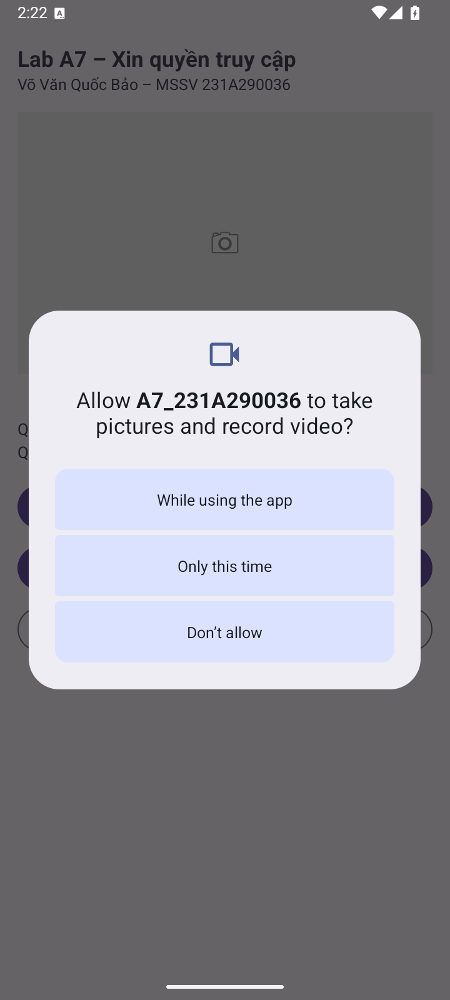
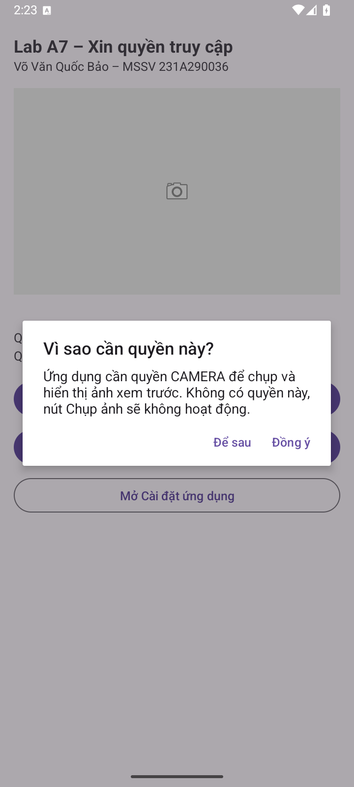
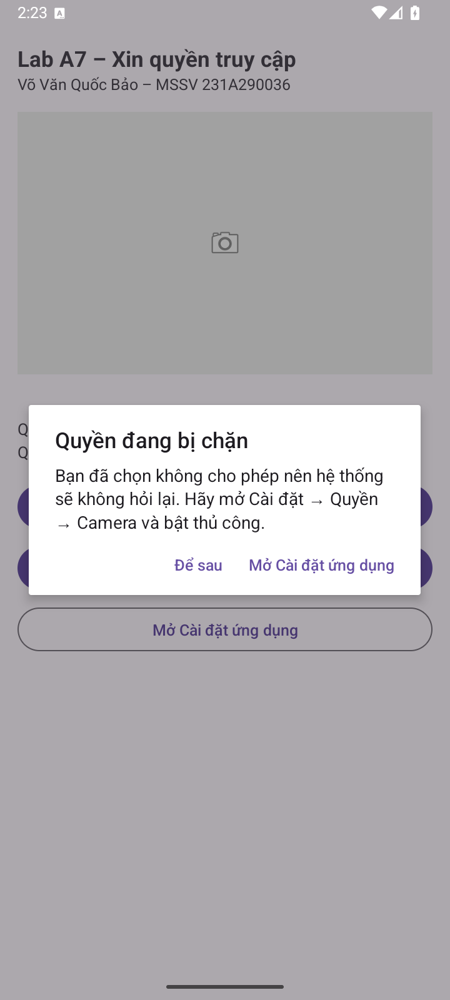
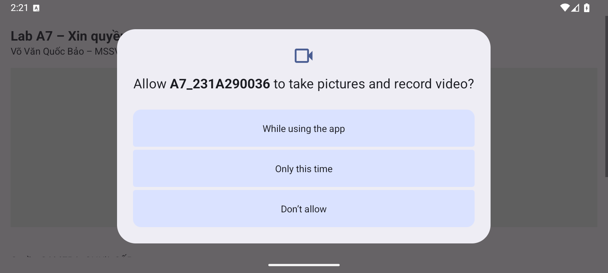
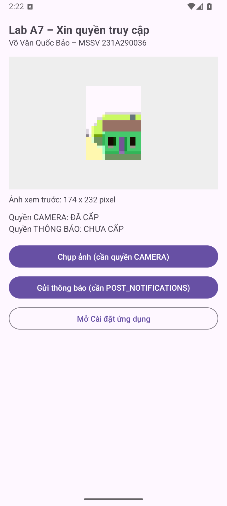
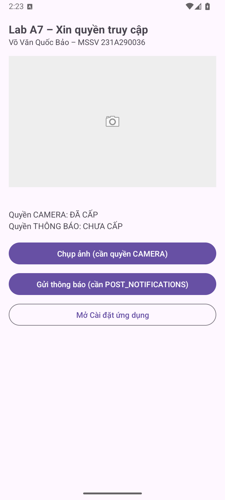
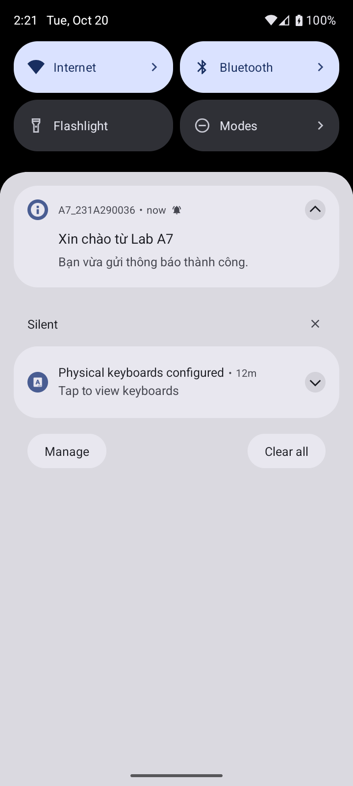
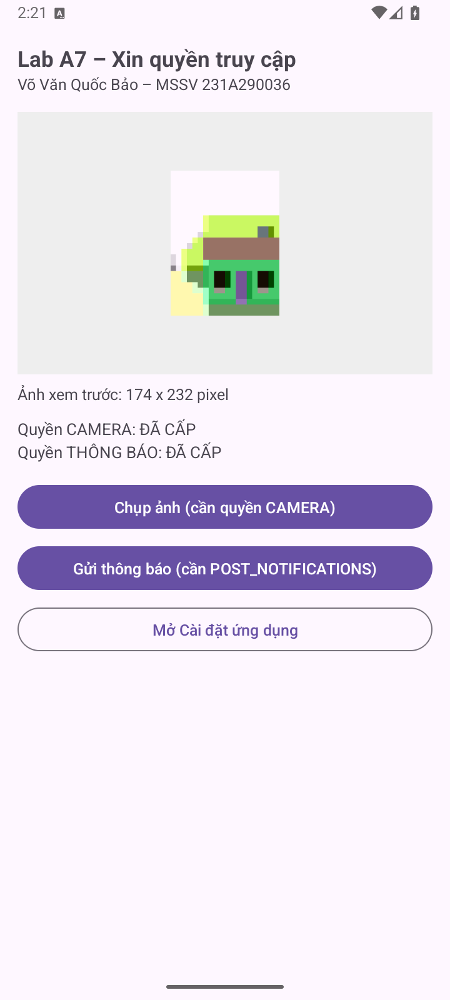
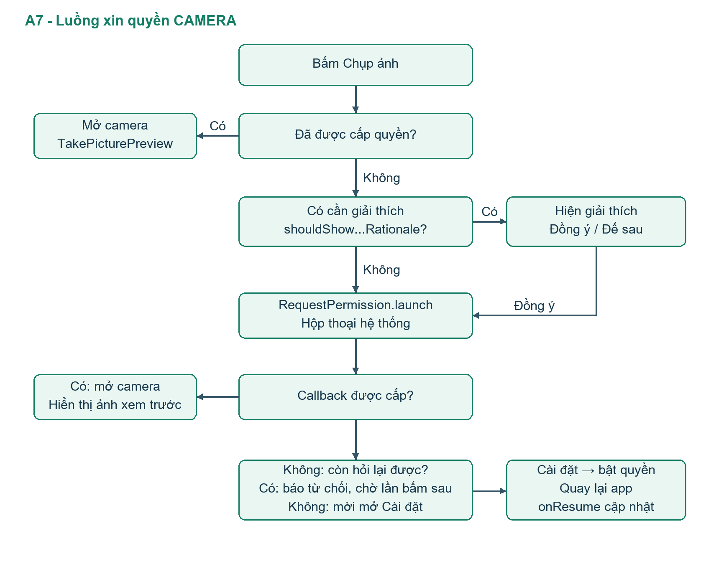

# BÁO CÁO LAB A7 - Xin quyền truy cập tài nguyên khi chạy
Họ tên: Võ Văn Quốc Bảo  |  MSSV: 231A290036

Học phần: INT4211 - Lập trình trên các thiết bị di động. Ngày kiểm chứng: 20/10/2026.

Repository: https://github.com/VOVANQUOCBAO/A7_231A290036

## 1. Thiết kế và phần nâng cao

Manifest khai báo CAMERA và POST_NOTIFICATIONS trực tiếp dưới manifest; camera required=false. Các launcher RequestPermission và TakePicturePreview được đăng ký ở cấp field. Kiểm tra quyền ở thời điểm bấm và cập nhật lại trong onResume.

CAMERA có đủ nhánh đã cấp, cần giải thích và lần đầu/bị chặn. Khi từ chối lần đầu, app báo ngắn và chờ thao tác tiếp; lần bấm sau mới giải thích. Khi bị chặn, app dẫn vào Cài đặt. Ảnh thu nhỏ được lưu nội bộ để phục hồi khi xoay; trạng thái quyền và kích thước ảnh là hai dòng riêng.

NC3: PendingIntent với FLAG_IMMUTABLE mở lại app khi chạm thông báo. NC4: sơ đồ luồng quyền bằng hình và mã Mermaid trong BaoCao/SoDoQuyen.mmd.

## 2. Bảng 7 kịch bản đã chạy

| # | Thao tác | Kết quả thực tế / ảnh |
| --- | --- | --- |
| 1 | Cài mới, bấm Chụp ảnh | Đạt: hộp thoại CAMERA hệ thống (01). |
| 2 | Cho phép, chụp và xác nhận | Đạt: Bitmap xem trước hiện trong khung; kích thước pixel hiển thị (02). |
| 3 | Từ chối lần 1, bấm lại | Đạt: giải thích của app hiện trước khi xin lại (03). |
| 4 | Từ chối lần 2, bấm lại | Đạt: app mời mở Cài đặt; hệ thống không hỏi lại (04). |
| 5 | Bật Camera ở Cài đặt, quay lại | Đạt: onResume tự cập nhật ĐÃ CẤP (05). |
| 6 | Gửi thông báo trên Android 13+ | Đạt: hỏi POST_NOTIFICATIONS, tạo kênh và thông báo thật; chạm mở app (06, NC3). |
| 7 | Xoay khi hộp thoại đang hiện | Đạt: Activity tạo lại và callback vẫn nhận kết quả cấp quyền (07). |

---

## 3. Hộp thoại xin quyền và từ chối

---

## 4. Sử dụng tài nguyên và quay về từ Cài đặt

---

## 5. NC4 - Sơ đồ luồng quyền

Nhánh Để sau chỉ đóng hộp thoại. Lần gọi bị hệ thống chặn trả false ngay; callback thấy không còn rationale thì hiện hướng dẫn Cài đặt. App không tự lặp việc hỏi quyền. POST_NOTIFICATIONS chỉ xin từ API 33; kênh thông báo chỉ tạo từ API 26.

---

## 6. Trả lời 3 câu hỏi phân tích

1. Vì sao không hiện hộp thoại sau lần từ chối thứ hai? Trên phiên bản máy ảo đang dùng, hệ thống xem việc từ chối lặp lại là chặn yêu cầu. Người dùng còn có thể vào Cài đặt → ứng dụng → Quyền → Camera để cấp lại. Trạng thái này được kiểm thử bằng hai lần từ chối thật trên hộp thoại, không dựng giả hộp thoại trong app.

2. Nếu đăng ký launcher trong onClick? Khi Activity đã RESUMED, đăng ký launcher quá muộn gây IllegalStateException. Một lượt kiểm thử riêng đã gọi thử và bắt ngoại lệ; không đưa mã sai này vào app chính. Thông báo nguyên văn:

LifecycleOwner vn.edu.vhu.ltdd.a7permission.MainActivity@9c476df is attempting to register while current state is RESUMED. LifecycleOwners must call register before they are STARTED.

3. Android 12 trở xuống có phải xin POST_NOTIFICATIONS? Không có runtime permission này trước API 33. App có thể gửi sau khi tạo kênh ở API 26+, nhưng người dùng vẫn có thể tắt thông báo trong Cài đặt; gửi không đồng nghĩa chắc chắn sẽ được hiển thị.

## 7. Trả lời 5 câu hỏi ôn tập

1. Quyền normal thường được cấp khi cài mà không có hộp thoại runtime; quyền dangerous cần khai báo Manifest và xin lúc chạy trên Android 6+ theo hành động có nhu cầu.

2. Đã cấp: dùng ngay. Còn cần rationale: giải thích, người dùng đồng ý mới xin lại. Lần đầu hoặc bị chặn: gọi RequestPermission, rồi phân biệt kết quả trong callback.

3. Đăng ký launcher ở field hoặc trước STARTED giúp nhận lại kết quả sau tái tạo Activity; đăng ký trong onClick khi RESUMED là quá muộn.

4. Trước yêu cầu, rationale=false có thể là lần đầu hoặc bị chặn. Sau callback bị từ chối, rationale=true còn hỏi lại được; rationale=false ở luồng kiểm thử này dẫn người dùng tới Cài đặt.

5. POST_NOTIFICATIONS chỉ tồn tại từ API 33, nên phải chặn theo Build.VERSION.SDK_INT; các máy cũ dùng nhánh gửi không xin runtime permission này.

## Môi trường và phạm vi kiểm chứng

Project Java + XML; minSdk 24, targetSdk/compileSdk 35, Java 17. Android Gradle Plugin 9.0.1; Gradle Wrapper 9.1.0. Máy ảo Medium Phone, Android API 36. Bộ kiểm thử instrumentation đạt 6 phép kiểm tra trong lượt chính.

APK được build và cài thật lên máy ảo. Ảnh ứng dụng được chụp trực tiếp từ máy ảo; video quay màn hình bằng adb screenrecord. Chưa kiểm chứng trên điện thoại thật hoặc máy API 24. Nhật ký gốc và kết quả lint nằm trong KiemThu/.

## Tệp nộp và khả năng tái lập

Thư mục gốc là project mở trực tiếp bằng Android Studio. APK/ chứa bản debug có chữ ký để cài thử; BaoCao/ chứa PDF và bản Markdown có thể sửa; AnhMinhChung/ chứa ảnh gốc; Video/ chứa video demo; KiemThu/ chứa log, báo cáo lint và cách chạy lại kiểm thử.

Nguồn yêu cầu: Lab_A7_HuongDanThucHanh.pdf do người dùng cung cấp. Repository để Private. Không gửi lời mời giảng viên theo yêu cầu của chủ tài khoản.
